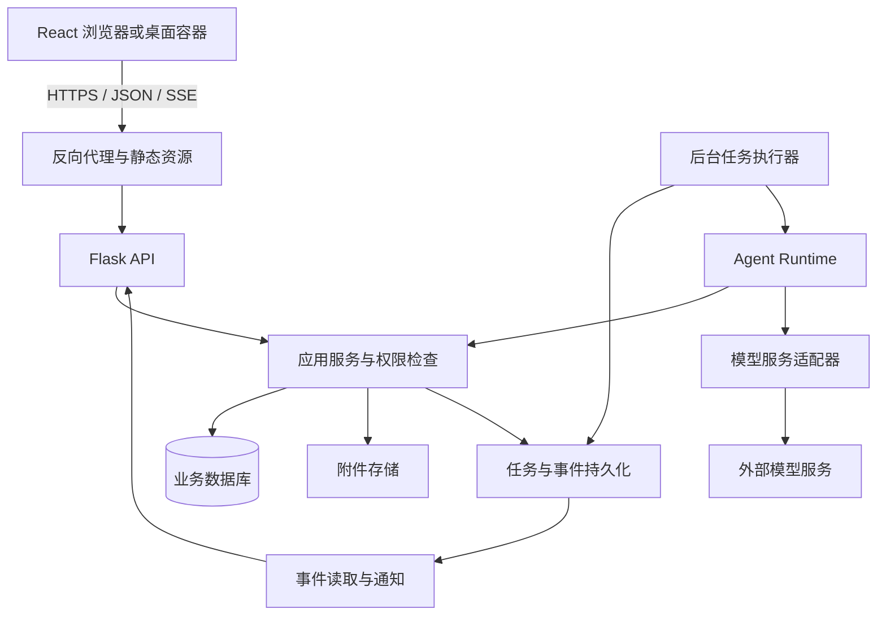

# ExperMate 服务端集中运行与 React 前端重构方案

> 编写日期：2026-10-15
>
> 状态：React 前端迁移完成；服务端集中化待实施，已落地范围见第 12.3 节
>
> 依据：当前工作区源码及本轮讨论；方案最初基于静态阅读，后续实施已增加自动化测试与隔离浏览器验收，见第 12 节。
>
> 核心方向：服务端负责业务、智能体、模型调用、数据与附件；React 客户端负责交互。

## 1. 目标、范围与默认假设

### 1.1 已确定的方向

1. 从“设备本地运行完整应用、服务端主要承担数据共享”转向“完整应用集中运行在服务端”。
2. 使用 React 重构前端。
3. 延续实验记录智能体的主要功能，包括对话记录、实验复刻、结构化编辑、分析报告、附件、分类与聊天历史。
4. 兼容已有实验数据，迁移不能以丢失历史或重置账号为默认手段。

这里的“所有服务放到服务端”，指目前设备上的 Python 后端、Agent、数据库和文件处理集中运行；用户浏览器中的界面渲染、文件选择、音频播放等交互仍由客户端执行。模型可以继续调用外部模型服务，不默认包含服务器自建模型推理集群。

### 1.2 本方案采用的默认假设

| 项目 | 本文默认方案 | 状态 |
|---|---|---|
| 部署形态 | 一套服务端支持多个独立账号 | 假设，可简化为个人私有部署 |
| 数据归属 | 第一版按账号隔离 | 建议 |
| 数据共享 | 同账号多设备访问优先；跨账号共享另行定义权限 | 待确认跨账号需求 |
| 联网要求 | 核心业务需要连接服务端 | 建议，不引入离线写入与双向同步 |
| 桌面端 | 浏览器优先，可保留 pywebview 作为远程网页容器 | 建议 |
| 模型配置 | 管理员配置实例默认模型；用户自带密钥按产品决定启用 | 待确认 |
| 数据保密边界 | 服务端可读取业务明文，按请求调用模型 | 架构前提，须更新产品说明 |
| 初期规模 | 单区域、单实例部署起步 | 假设，压测后决定扩容 |

本方案不默认增加团队空间、复杂角色系统、付费计费、公开分享、插件市场、原生移动端和向量数据库。若需要团队协作，应在数据模型定稿前补充工作空间与成员权限设计。

### 1.3 成功标准

- 用户无需安装 Python、配置本地数据库或启动 Flask 即可使用核心功能。
- 同账号在多个设备上看到相同的实验、聊天和任务状态。
- 提交的 Agent/分析任务不因页面关闭或流连接断开而停止。
- 未登录请求不会读写公共离线数据；越权请求无法通过 ID、搜索、附件或事件订阅获得数据。
- 并发编辑产生明确版本冲突，不静默覆盖；日志与引用关系随业务写入保持一致。
- 旧数据可校验迁入；切换失败时有明确回退路径。
- 新系统有可重复的部署、备份、恢复与升级流程。

## 2. 现状与源码依据

### 2.1 当前系统构成

| 位置 | 当前职责 | 重构影响 |
|---|---|---|
| `app.py` | 配置加载、仓储和服务装配、认证解析、同步网关、桌面启动 | 拆分启动和装配；取消服务端匿名离线回退 |
| `ai-shell/index.html` | 聊天与内容双栏外壳 | 迁移为 React 布局 |
| `ai-shell/static/js/panel.js` | 客户端路由、片段加载、Canvas、分栏、状态恢复 | 分离导航、画布、布局与页面状态 |
| `ai-shell/static/js/agent.js` | 主会话状态、消息流、跨窗口事件流 | 改为任务订阅和消息状态管理 |
| `templates/experiments.html` | 实验列表、分类、筛选及内联交互 | 迁移为实验功能模块 |
| `static/js/child-agent.js` | 实验编辑和报告审阅子会话 | 共用聊天组件和协议，保留角色限制 |
| `routes/fragments.py` | 生成注入右栏的 HTML 片段 | 由 JSON 查询接口替代 |
| `routes/api_agent.py` | Agent 恢复、执行、流式输出、进程内运行锁和事件广播 | 提取运行服务与事件分发 |
| `routes/api_child.py` | 子 Agent 的构建、执行及状态保存 | 与主会话共用任务基础设施 |
| `lib/agent_v2.py` | 工具、模型循环、状态、历史修复和上下文整理 | 按职责拆分，保持既有行为 |
| `lib/services/` | 实验、分析、提取与模板服务 | 延续并补齐业务边界 |
| `lib/repositories/` | SQLite 仓储、版本校验和历史查询 | 保留接口，增加事务和迁移能力 |
| `lib/attachment_store.py` | 按账号和 SHA-256 存储附件 BLOB | 迁移为服务端附件元数据与内容存储 |
| `lib/e2ee/flask_setup.py` | 当前账号认证、密钥及恢复装配 | 账号迁移与密码恢复需单独设计 |
| `lib/e2ee/`、`relay/` | 加密设备同步与中继 | 迁移期间保留读取能力，最终退出主业务路径 |

### 2.2 已有基础应当保留

- 实验的 `revision` 和条件更新能力。
- 实验更新日志、引用关系、归档语义。
- 分析报告的 `source_snapshot`，以及源实验变化提示。
- 主会话、实验编辑子会话与分析审阅子会话的范围限制。
- 原始聊天、压缩历史与模型摘要分开的设计意图。
- Repository、Service、LLM 抽象及现有测试。
- 附件内容哈希与账号作用域校验。

### 2.3 集中部署前必须处理的差异

1. `app.py` 当前把未认证请求切换到 `offline.db`。公网服务端应返回 401，不应自动进入共享匿名数据库。
2. 当前配置主要是实例级配置；普通用户保存设置不能修改其他账号使用的模型、端口或服务启动参数。
3. Agent 运行锁、活动任务与订阅者主要位于进程内；现有部署文档因此要求单 worker，不能直接增加 worker 数量解决并发。
4. 主 Agent 的生成发生在 HTTP 响应生成器中；子 Agent 也依赖流请求执行。服务端任务需要独立于连接生命周期。
5. `ThreadSafeConnection` 使用自动提交，业务保存、日志、引用等跨语句操作需要显式事务。
6. 已有 `sync_queue` 和 dirty 回调；新系统应复用其持久化变更思路，但设备同步队列不直接等于任务队列或客户端事件日志。
7. 当前账号恢复装配中存在 `RecordingMailSender`、内存安全日志和文件密钥等实现，公开服务不能仅靠移动部署地址就视为生产账号系统。
8. `/api/experiments/search` 返回完整集合，引用解析存在全量扫描。服务端需要真正的分页、筛选、检索和摘要接口。

以上是架构观察，不表示每一项均已复现为运行故障。

## 3. 目标架构与技术决策



图中是职责边界，不要求每个方框成为独立微服务。初期采用模块化单体：一个代码仓库、API 进程和后台执行进程，共用受控数据库与文件存储。

### 3.1 推荐选型

| 层次 | 建议 | 原因 |
|---|---|---|
| 前端 | React、TypeScript、Vite | 与现有 Python API 配合，支持静态部署 |
| 路由 | React Router | 替换自制路由，支持深链接与嵌套布局 |
| 服务端数据缓存 | TanStack Query | 统一查询、写入后刷新和分页 |
| 临时交互状态 | 组件状态、Context 与 reducer | 第一阶段避免额外全局状态框架 |
| API | 保留 Flask | 已有蓝图和服务基础，先解决边界问题 |
| 数据库 | 过渡使用 SQLite；多人正式运行以 PostgreSQL 为推荐目标 | 避免把数据库改写与第一轮前端迁移捆绑 |
| 流式交互 | REST 提交任务、SSE 订阅事件 | 与当前事件模式接近，支持断线恢复 |
| 执行器 | 先实现数据库持久化任务与独立 worker | 单机即可验证可靠性，之后按负载接入任务队列 |
| 附件 | 初期持久化目录；后续可切对象存储 | 附件与数据库分开备份、扩容 |
| 发布 | 同源部署、静态资源本地构建 | 简化认证、跨域及版本配套 |

React 官方说明 Vite 可以构建客户端 SPA，同时需要自行组合路由与数据获取；这里的选择基于交互工具的需求，不是所有网站的通用选型。[React 文档](https://react.dev/learn/build-a-react-app-from-scratch)

初期不引入微服务、Kubernetes、复杂工作流框架或自建模型集群。是否替换 Flask、引入 Redis/消息代理，由压测和运行需求决定。

### 3.2 部署阶段

- 过渡验证：单 API 进程、一个独立 worker、SQLite、持久化附件目录。只用于受控试运行，保持 SQLite 写事务短小。
- 多账号正式版本：完成权限、任务恢复、备份演练与压力测试；推荐切换 PostgreSQL 后再增加 API/worker 数量。
- 扩展阶段：按需要增加对象存储、专用消息代理或多个 worker。数据库仍是任务与事件真值，消息通知只是唤醒手段。

## 4. React 前端设计

### 4.1 目录与组件边界

```text
frontend/
  src/
    app/                    # 入口、路由、Provider
    layouts/                # 常驻聊天区、内容区、移动布局
    features/
      chat/                 # 消息、工具卡、选择器、历史、运行状态
      experiments/          # 列表、详情、编辑、分类、比较
      analysis/             # 报告、证据来源、来源变化提示
      attachments/          # 上传、预览、下载
      account/              # 登录、会话、恢复
      settings/             # 个人设置与模型设置
    components/             # 按钮、弹窗、空状态等通用 UI
    api/                    # HTTP、SSE、生成的契约类型
    platform/               # 浏览器、pywebview 下载适配
    styles/                 # 现有设计令牌与功能样式
```

聊天区挂载在常驻布局中，右侧路由切换不能导致聊天区或任务订阅被卸载。实验子会话和报告审阅共用消息组件，但会话标识、草稿和权限相互隔离。

Canvas 保留为独立组件，通过 ref/effect 管理画布与动画；卸载时清理监听器和动画帧。不要把逐帧画布状态放进 React 全局状态。

### 4.2 状态归属

| 数据 | 权威位置 | 客户端处理 |
|---|---|---|
| 实验、分类、报告、附件元数据 | 服务端数据库 | Query 缓存 |
| 消息、任务、工具结果、摘要 | 服务端 | 分页读取与事件合并 |
| 查询条件、排序、比较对象 | URL | 路由参数 |
| 未提交输入与编辑草稿 | 当前浏览器 | 可按账号、会话、资源保存草稿 |
| 主题、分栏宽度 | 浏览器偏好 | 本地持久化 |
| 会话凭证 | 推荐 HttpOnly Cookie | 不复制到 localStorage |
| 模型密钥 | 服务端密钥存储 | 页面仅显示是否配置及脱敏标识 |

Query key 必须带账号或明确的权限作用域。退出、换账号时关闭事件连接并清空缓存；本地草稿按账号隔离，不能把上一账号的内容带入下一账号。

列表的筛选、分类与分页由后端执行，避免前端加载全量实验再过滤。收到资源事件后按资源 ID、类型与 revision 更新或失效缓存，不整页刷新。

### 4.3 交互与兼容策略

- 第一轮保持现有视觉风格和主要操作路径，复用 CSS 变量和静态音频。
- Quill 先做组件包装；是否更换编辑器另行评估数据格式与粘贴兼容性。
- 报告和模型输出的 Markdown 统一渲染并清理不受信任 HTML；React 本身不能保护手工插入的原始 HTML。
- 流文本分批刷新，避免每个 token 重绘整个消息列表；完成消息与历史消息按稳定 ID 合并。
- 页面切换、重连和双窗口均不得重复创建消息或重复执行工具。
- 冲突时保留编辑草稿，展示最新版本并允许重新编辑；不自动重放写操作覆盖他人更改。
- 上传进度、提取进度与 Agent 运行状态分开显示；附件上传成功不等于内容提取成功。
- 音频播放属于客户端能力，服务端保存曲库或偏好，不因一次广播强制所有设备播放。

### 4.4 入口切换

迁移期提供 `/app/` 新入口；旧入口用于对照，两个入口不同时操作一块 DOM。React 构建资源使用固定前缀和内容哈希。

生产环境配置深链接回退，但 `/api/`、静态文件缺失和附件下载错误不得回退成 `index.html`。明确 Vite base、路由 basename 与代理前缀的一致关系。

初期保留 Jinja 打印页时，必须增加服务端认证与资源权限检查，并接入同一应用服务。打印不因暂缓 React 迁移而成为权限例外。

## 5. 后端模块与接口契约

### 5.1 逻辑分层

```text
HTTP 路由 / Agent 工具 / 管理命令
                 ↓
应用服务：权限、业务规则、事务、结果
                 ↓
仓储与外部适配器：数据库、文件、模型
```

禁止路由调用另一个路由函数完成业务。实验创建、编辑、归档和引用维护走统一应用服务；Agent 工具也走同一入口，防止 UI 修改与模型修改产生不同规则。

先在现有 `lib/services/`、`lib/repositories/` 上调整。仅在职责稳定后做目录移动，避免大规模改名掩盖行为变化。

建议新增或明确：`RunService`、`ConversationService`、`AttachmentService`、`SearchService`、`AccountService`、`ModelSettingsService`。不为每个 HTTP 接口机械创建一个类。

### 5.2 应用装配

- 配置读取、连接创建、容器和扩展初始化移入应用工厂。
- API、worker 和迁移命令分别建立资源生命周期，不能 import `app.py` 就启动同步或创建业务文件。
- 后台任务显式携带认证后的用户上下文，不依赖 `flask.g` 或 `test_request_context()`。
- 管理员实例设置与个人业务设置分开，端口、数据目录、注册开关不可由普通用户修改。
- 服务端认证初始化失败时应启动失败或 readiness 失败，不能静默降级为无认证模式。

Flask 应用工厂可支持不同配置的独立实例，适合测试与拆分运行入口。[Flask 文档](https://flask.palletsprojects.com/en/stable/patterns/appfactories/)

### 5.3 建议的 API 面

以下为新契约草案，统一放在 `/api/v1` 下；不是当前已存在的接口。

| 方法与路径 | 用途 | 关键约束 |
|---|---|---|
| `POST /auth/login`、`POST /auth/logout` | 登录、退出 | 限流、会话撤销 |
| `GET /auth/me` | 当前身份 | 不返回密钥或密码材料 |
| `GET /experiments` | 列表、筛选、检索 | 游标分页、摘要字段、用户作用域 |
| `GET /experiments/{id}` | 完整实验 | 资源访问检查 |
| `POST /experiments` | 显式创建 | 幂等键、结构校验 |
| `PATCH /experiments/{id}` | 编辑 | 必须提交 expected_revision |
| `POST /experiments/{id}/archive`、`/restore` | 归档、恢复 | revision、日志、事务 |
| `GET /experiments/{id}/updates` | 修改历史 | 分页、资源权限 |
| `GET /analyses`、`GET /analyses/{id}` | 报告及来源 | 保留快照与来源变化信息 |
| `POST /conversations` | 创建会话 | 类型与关联资源校验 |
| `GET /conversations/{id}/messages` | 聊天分页 | 稳定消息 ID 与游标 |
| `POST /conversations/{id}/runs` | 提交消息、创建任务 | 返回 202 与 run_id |
| `GET /runs/{id}` | 状态与恢复快照 | 权限、终态与错误码 |
| `GET /runs/{id}/events` | 任务 SSE | 游标补取、权限校验 |
| `POST /runs/{id}/actions` | 提交实验选择等交互结果 | 校验 pending action、revision、幂等 |
| `POST /runs/{id}/cancel` | 请求取消 | 合作式取消，返回当前状态 |
| `GET /events` | 账号资源变更 | 独立资源事件游标 |
| `POST /attachments` | 上传附件 | 大小、类型、配额与归属 |
| `GET /attachments/{id}`、`/{id}/preview` | 下载与预览 | 内容哈希不能代替权限 |
| `GET /settings`、`PATCH /settings` | 个人设置 | 与实例管理员设置分离 |
| `GET /templates`、`GET /collections` | 模板与分类 | 只暴露获准数据 |

旧接口通过薄适配层调用新服务，兼容期不维持两份业务实现。哪些旧入口保留、何时返回弃用提示，应列入发布说明。

### 5.4 数据与错误格式

成功响应建议使用 `data` 和可选 `meta`；错误使用稳定错误码，用户文案独立维护。

```json
{
  "error": {
    "code": "revision_conflict",
    "message": "记录已更新，请先核对最新版本",
    "details": {"current_revision": 12}
  },
  "request_id": "req_example"
}
```

400 用于非法请求，401 用于未认证，403 用于禁止操作，404 用于不可访问或不存在的资源，409 用于版本和运行冲突，413 用于附件超限，429 用于配额或限流。具体资源是否统一使用 404，按防枚举策略固定，避免每个路由自行决定。

采用 Pydantic 定义请求、响应和事件模型，生成 OpenAPI/JSON Schema 并导出 TypeScript 类型；Flask 不会自动完成这条链路，需要明确生成脚本和 CI 漂移检查。DTO 不直接等于数据库行，模型输出也必须经过服务端校验。

## 6. Agent 与任务运行设计

### 6.1 拆分现有 Agent

| 模块 | 从当前代码提取的职责 |
|---|---|
| Runtime | 模型请求、工具循环、停止条件、事件产出 |
| Tool handlers | 实验、分析、附件、检索、分类等工具 |
| Conversation history | 原始消息、工具配对、历史修复 |
| Context manager | 上下文构造、压缩摘要、压缩原文归档 |
| State persistence | 会话快照、检查点、版本升级 |
| Policy | 主 Agent、实验编辑、报告审阅的工具与资源范围 |

保留现有工具注册表作为入口，不另建插件机制。`run()` 和 `run_stream()` 逐步统一到一个事件驱动执行核心，非流式调用消费事件形成汇总，避免两套循环分叉。

### 6.2 任务状态机

```text
queued → running → succeeded
             ├──→ failed
             ├──→ interrupted
             └──→ waiting_input → queued

queued / waiting_input → cancelled
running → cancel_requested → cancelled / succeeded / failed
```

`waiting_input` 用于实验选择等人工交互，保存待处理 action 和检查点后释放 worker。提交 action 必须匹配任务、会话、当前检查点和用户权限，重复提交返回同一结果。

取消不等于回滚已完成的工具写入；外部模型调用不保证即时停止。若任务已完成，取消接口返回真实终态，不覆盖成 cancelled。

### 6.3 任务执行流程

1. API 验证用户、会话、附件归属与模型配置。
2. 在同一事务内保存用户消息、任务记录及会话运行约束，提交后返回 run_id。
3. worker 原子认领任务，获得带有效期的 lease 和递增 fencing token。
4. 执行模型与工具，持久化必要事件、工具结果和检查点；不在数据库事务中等待模型响应。
5. 成功时在事务内保存最终消息、会话状态与任务终态；失败时保存可展示的错误和已完成步骤。
6. 客户端订阅事件或重新读取状态，不承担任务继续执行的责任。

默认每个会话最多一个活动任务，按账号设置运行并发上限。会修改同一个实验的不同会话仍通过实验 revision 协调，不简单锁住整个账号。

### 6.4 幂等、重试与进程故障

- 提交任务使用客户端幂等键，唯一范围为账号和提交操作；相同键不同请求内容返回冲突。
- 数据库唯一约束保证同一会话活动任务限制，不能只依赖 Python 锁。
- worker 心跳、lease 和 fencing token 防止过期执行器继续提交结果；工具事务检查有效执行权。
- 模型请求可按错误类型有限重试；写入工具、外部副作用不能无条件重试。
- 工具执行使用稳定 operation_id；重复执行返回已保存结果，避免重复创建实验或报告。
- 进程重启后先核对工具结果与检查点。无法证明安全恢复的任务标记 interrupted，提供继续或新建操作，不宣称任意位置无损恢复。
- “请求已发往模型但结果未收到”可能造成重复计费，不能承诺外部调用 exactly-once。

### 6.5 事件协议与重连

事件至少包含：`event_id`、`run_id`、`conversation_id`、`type`、`schema_version`、`created_at` 和 `payload`。类型覆盖文本增量、工具开始/完成、等待输入、状态变化、完成和失败。

```text
id: 42
event: run.text_delta
data: {"schema_version":1,"run_id":"run_example","payload":{"text":"正在整理"}}

```

SSE 使用标准空行分隔事件，支持 `Last-Event-ID` 或显式 after 游标。文本增量可合并成块，工具结果、消息和终态必须可靠保存。客户端按稳定 ID 去重，不按文本内容猜测重复。

任务流与账号资源流拥有各自游标。游标过期时返回需要重新拉取快照的信号；客户端读取当前任务/资源状态后重新订阅。断开期间错过的资源通知可通过快照刷新收敛。

服务端配置心跳、代理缓冲关闭、合理空闲超时、订阅队列上限及慢客户端断开策略。原生 EventSource 使用同源 Cookie；若采用 Bearer，则使用支持 Header 的 fetch 流解析。禁止把长期凭证放在事件 URL 中。[SSE 格式说明](https://developer.mozilla.org/en-US/docs/Web/API/Server-sent_events/Using_server-sent_events)

## 7. 数据模型、事务和检索

### 7.1 建议实体

| 实体 | 关键字段或关系 |
|---|---|
| users / sessions | 不可变用户 ID、密码哈希、会话状态、账号 epoch |
| experiments | owner_id、内部 ID、显示编号、内容、revision、归档状态 |
| experiment_updates | 实验 ID、操作者、来源、字段差异、关联 run_id |
| experiment_references | 来源、目标、引用类型，所有者约束 |
| analyses | 问题、正文、源实验、不可变来源快照 |
| conversations | owner_id、类型、关联实验或报告、状态 |
| messages | 稳定 ID、会话序号、角色、内容、工具关联 |
| conversation_states | 带 schema_version 的运行快照与检查点 |
| runs / run_events | 状态、幂等键、lease、检查点、事件序号、错误 |
| tool_operations | operation_id、执行状态、业务结果 |
| attachments / attachment_links | 所有者、哈希、存储键、提取状态、资源关联 |
| user_settings / model_credentials | 用户偏好、模型配置、加密凭证引用 |
| resource_events / outbox | 已提交业务变化及待投递状态 |
| migration_batches / migration_items | 来源、映射、校验结果和可追踪的导入状态 |

不要求第一轮建立所有新表。先为当前表补齐归属、任务和迁移能力；消息逐行存储可以与旧 JSON 历史兼容读取过渡。

实验类型各异的结构字段可保留 JSON；列表筛选、权限、状态、日期和版本字段保持可索引列。不要把所有材料、步骤、结果立即拆成几十张表。

### 7.2 标识与账号隔离

显示编号与内部稳定 ID 分离，保留旧实验编号供阅读和引用。禁止直接把来自多台设备的显示编号假定为全局唯一。

外键、唯一约束与查询均携带所有者边界；跨账号相同编号、相同附件哈希不应互相覆盖或泄露存在性。服务端 ID 由服务器生成，不能信任请求体中的 owner_id。

PostgreSQL 可增加行级安全作为纵深防护，但不能替代应用授权；表所有者和 BYPASSRLS 角色的绕过行为需要单独测试。[PostgreSQL 文档](https://www.postgresql.org/docs/current/ddl-rowsecurity.html)

### 7.3 事务边界

一次实验修改中的版本检查、正文更新、更新日志、引用维护、幂等结果和资源事件应在同一事务内提交。

附件内容写入文件系统或对象存储无法与数据库共享事务：先写临时内容并校验，再提交元数据和关联；清理无引用临时内容，失败记录可重试。不能在数据库已声明上传成功时丢失附件本体。

分析时按固定快照读取证据，记录实验 revision 与附件哈希；模型请求在事务外执行。报告保存和关联更新使用短事务，避免回写旧实验全量内容覆盖分析期间的新修改。

outbox 用于可靠发布已提交变更；任务队列负责执行；run_events 负责任务回放。三者用途不同，不用一张无限增长的通用队列表承担全部职责。

### 7.4 数据库迁移与检索

- 采用版本化迁移脚本，替换散落在仓储构造函数中的隐式 ALTER 行为；生产迁移由发布命令串行执行。
- 为主键、所有者、时间、会话序号和 revision 冲突路径建立索引及约束。
- 提取统一 SearchService，前端查询、引用解析和 Agent 检索复用排序与权限规则。
- SQLite 过渡阶段验证已有 FTS5；切 PostgreSQL 时重建检索索引，并单独验收中文实验术语、编号、材料与标签检索质量。
- 先建立真实检索样例，再决定中文分词或语义检索方案，不把向量数据库作为迁移前置条件。
- 列表采用稳定排序和游标分页，搜索结果默认不返回完整原始实验正文。

## 8. 认证、密钥与服务端访问边界

### 8.1 认证与权限

推荐同源部署与 Secure、HttpOnly、SameSite Cookie；状态变更请求加 CSRF 防护和来源校验。Cookie 的具体 SameSite 策略结合登录流程验证，不把它当作唯一 CSRF 防护。

所有业务 API、打印、事件订阅、预览、下载、检索和后台工具执行必须验证身份及资源权限。健康检查、登录等公开接口使用显式白名单。

任务提交时校验一次权限，工具执行和文件读取时再次确认当前授权。账号禁用、资源归属变化和会话撤销不能只靠前端隐藏按钮。

账号恢复必须替换演示邮件发送并验证邮件通道；安全日志需要持久化。密码修改/恢复后撤销旧会话，记录操作并限制恢复尝试。未完成这些能力时，不对外提供不可用的“找回密码”入口。

### 8.2 模型设置和凭证

- 实例配置：域名、数据库、存储、默认模型、注册策略、运行限额，由管理员管理。
- 用户配置：个人偏好与获准的模型覆盖项，由本人管理。
- 若允许用户自带 API Key，服务端加密存储，解密权限限于执行器；前端不能读取完整历史密钥。
- 若允许用户自定义模型 base URL，需要限制协议、目标网络和重定向，防止服务端请求访问内部管理服务；管理员专门配置的内网模型可单独授权。
- 服务端按用户记录用量、限制排队和并发，避免单账号占满执行器；计费产品不包含在本轮范围内。
- 外部模型仍可能接收实验和附件内容，应明确配置和请求边界；集中部署不会让第三方模型调用自动变成本地推理。

### 8.3 加密方案的变化

旧方案的信任边界是：中继持有密文，本地应用持有可用明文。新方案中服务端执行 Agent，需要读取实验和附件明文。因此服务端不能同时被描述成“只持有密文且无法读取内容”的中继。

目标采用 HTTPS、存储与备份加密、密钥分离和访问审计。数据库可解密的服务器加密不称为客户端独占密钥的端到端加密。

旧密码哈希与账号身份、旧 DEK/恢复材料、业务数据迁移是不同问题。不得直接取消 e2ee 初始化并删除账号库；先设计身份映射和凭据转换，再退役设备密钥链。

## 9. 附件与内容提取

附件内容通过 AttachmentService 统一读取，Agent 不接受客户端任意本地路径或任意 URL 作为可信文件来源。

初期存储键按账号和内容哈希构造，保持账号内去重；对象存储桶不公开。下载使用受权 API，或短期、受限的签名地址，签名不能绕过资源授权。

服务端限制单文件大小、文件数量、总配额、解析时间和提取结果大小。PDF、表格、图片、OCR 等解析在受限任务中执行，检查真实文件类型并限制压缩展开规模。

提取结果按内容哈希、提取器版本和模型配置版本缓存；状态包含 pending、running、ready、failed。报告引用原附件与提取版本，避免解析器升级后无法解释旧报告来源。

本文不要求第一轮扩大现有 16 MB 限制；实际上传上限应由代理、API 与 worker 一致执行。

## 10. 旧数据与账号迁移

### 10.1 迁移范围

- 各设备 `data.db` 中的实验、报告、分类、附件、更新日志与聊天。
- `offline.db` 中尚未导入账号的数据。
- 线程 JSON、压缩原文、用户画像和运行态中具有历史价值的信息。
- 账号库、凭证、恢复材料及必要的身份映射。
- SQLite 附件 BLOB 与旧 uploads 路径中的附件。
- 只有中继持有的加密数据包，需要通过已有解密能力恢复后导入。

清点以实际数据库和文件为准，不假设所有版本拥有相同表结构。备份运行中的 SQLite 使用一致性备份方式；不能只复制主文件而遗漏 WAL 中未合并的数据。

### 10.2 推荐迁移流程

1. **清点与备份**：记录设备、账号、数据库版本、附件规模、完整性摘要；冻结旧设备写入时间窗口。
2. **离线试导入**：可信本地迁移器读取数据，生成版本化迁移包与清单；禁止上传原始配置和全部密钥材料到普通业务接口。
3. **身份确认**：用户在新服务端登录并确认旧账号归属。不同安装的同名账号不能自动合并；无法复用密码凭据时走可验证的重设或认领流程。
4. **规范化与映射**：建立旧内部 ID、显示编号、账号与新内部 ID 的映射，重写结构化引用和附件关系。
5. **重复与冲突处理**：同一导入批次重复运行不重复创建；多设备版本不简单按时间戳覆盖，不把设备时钟当成可信全序。不能确定的新旧版本保留冲突副本供确认。
6. **导入与校验**：按批次记录条目状态，核对数量、哈希、引用、聊天顺序和来源快照；历史快照保留原证据，不静默改写成最新实验。
7. **业务验证**：抽样打开实验、下载附件、查看报告、恢复聊天并检索。
8. **正式切换**：旧客户端停写，最终增量核对后开放新系统写入；保留旧环境只读备份。

旧运行态不能直接恢复为服务器中的运行中任务。迁移历史和可解释的上下文，活动任务标记为已中断；新任务重新构建明确的会话上下文。

### 10.3 校验与回退

| 对象 | 校验内容 |
|---|---|
| 实验 | 数量、归属、编号映射、正文摘要、revision、归档状态 |
| 附件 | 引用数量、内容 SHA-256、字节数、可下载与可预览 |
| 报告 | 正文、来源快照、引用实验和附件可解释性 |
| 聊天 | 消息数量与顺序、工具配对、压缩原文可查 |
| 分类与日志 | 分类成员、置顶顺序、字段差异与操作者来源 |
| 安全 | 无跨账号合并、无密钥误导出、恢复流程可用 |

新系统开放写入前，可丢弃试导入批次并重新迁移。开放写入后若需回退，必须停止新写入并备份新系统增量，选择恢复新版本或经过验证的反向导出；不能直接启动旧库并放弃新记录。

设备同步中继在迁移完成、备份和回退窗口结束后退役。迁移期保留解密和恢复工具，不等于继续支持长期双向同步。

## 11. 部署、运行与可观察性

初期部署包括 HTTPS 反向代理、React 静态资源、API、worker、数据库和持久化附件目录。Node 主要用于构建前端，生产运行不要求另起 Node Web 服务。

- liveness 检查进程，readiness 检查关键依赖与数据库迁移版本。
- API 与 worker 分开启动和关闭；关闭 worker 时停止认领新任务，完成或检查点化当前任务。
- 多 API 进程之间通过数据库事件及可选通知通道协调，不能共享 Python 字典假象。
- 日志携带 request_id、run_id、conversation_id、用户内部 ID、工具名和耗时；默认不记录完整实验、模型密钥及附件正文。
- 指标包括排队时间、首事件时间、任务完成率、模型错误、工具错误、冲突、事件重连、数据库锁等待和存储增长。
- 配置事件保留期、临时文件清理和失败任务保留策略；聊天与研究记录不能随事件清理被一并删除。
- 数据库、附件、账号数据、凭证加密密钥和恢复材料分项备份，并验证组合恢复能力。
- 发布采用数据库向前兼容的增量变更；明确 API 与 worker 的事件 schema_version 兼容范围。

容量压测至少覆盖并发用户、活动 SSE 数、并行分析任务、附件解析和数据量。验收延迟目标、备份 RPO/RTO 在获得部署规模后定稿，不在没有测量时承诺固定性能数字。

## 12. 分阶段实施与验收门槛

阶段按依赖排列，每个阶段应保持可评审的小变更。无需同时更换前端、数据库、账号体系和 Agent 框架。

| 阶段 | 主要工作 | 可交付成果 | 验收门槛 |
|---|---|---|---|
| P0：基线 | 功能清单、API/事件清点、测试基线、部署规模和产品决策 | 基线报告、决策记录 | 核心流程有可重现样例，既有失败单独记录 |
| P1：服务端基础 | 应用工厂、强制认证、账号权限、配置隔离、事务 | 可部署的受保护 API | 两账号隔离；匿名不进离线库；写入失败整体回滚 |
| P2：任务运行 | runs、worker、消息 ID、工具幂等、事件回放、取消 | 可恢复的 Agent 运行闭环 | 关闭页面任务继续；重启不重复写；重连不重复消息 |
| P3：数据准备 | 迁移器、附件存储、身份映射、数据库迁移、试导入 | 可校验的数据副本 | 重复导入幂等；附件哈希及核心关联一致 |
| P4：React 基础 | `/app/`、布局、路由、查询层、只读实验和报告 | 新前端只读闭环 | 深链接、分页、主题和多设备读取正常 |
| P5：React 业务 | 编辑、归档、附件、分类、设置、主/子会话、选择器 | 核心功能完整 | 关键流程与旧版对照；并发冲突保留草稿 |
| P6：正式切换 | 压测、备份恢复、正式迁移、发布与回退演练 | 可用的服务端集中版本 | 权限、数据、任务和恢复门槛全部通过 |
| P7：退出旧架构 | 移除片段脚本、匿名离线路径、旧同步及本地后端依赖 | 简化后的维护版本 | 旧路径无业务调用，恢复工具和必要归档仍可用 |

P3 的迁移试验与 P4 的只读页面可以在接口契约稳定后独立推进；P5 的聊天切换依赖 P2。团队规模未确定前不估算日历工期，按阶段验收分配实现批次。

### 12.1 建议第一批实现范围

第一批先完成 P0 与 P1 的最小闭环：

1. 建立隔离测试数据库和两账号测试样例。
2. 让应用工厂支持显式配置和独立资源实例。
3. 新增认证必需的实验列表、详情及条件修改 API。
4. 将修改、日志、引用更新放入明确事务。
5. 加入未登录、越权、revision 冲突与失败回滚测试。

第二批完成“提交任务—后台运行—事件恢复”的垂直闭环，再接入 React 聊天。这样可先验证服务端核心，而不把 UI 迁移误当成架构已经完成。

### 12.2 实施记录：2026-10-15

用户明确要求完整保留原有前端样式。框架迁移不得改变双栏布局、Canvas、字体、配色、尺寸、列表结构、弹窗和动效；视觉与行为对照是每一阶段的验收门槛。

先前生成的侧栏、卡片列表、独立登录页和替代 CSS 已撤掉。`/app/` 使用 React 渲染原 ShellFrame 和 ShellDialogs，直接复用原 CSS；当时原版与 React 共用外壳初始化脚本；现已由第 12.3 节的 ES 模块替代。

已增加原版 DOM、内联样式、资源顺序和按钮行为的对照测试，以及 `/app/` 路由前缀和后端权限回归。开发与构建见 `frontend/README.md`。此前新增的受保护只读 API 保留为后续基础；本批不代表任务后台化、统一事务、账号迁移及服务端集中部署已经完成。

### 12.3 业务迁移进度：2026-10-16（前端完成）

| 模块 | 当前实现 | 保留部分 |
|---|---|---|
| 账号 | React 管理弹窗及原登录页；Cookie 会话 | 旧客户端仍可使用原 token 协议 |
| 聊天 | React 消息、输入、上传、流式显示与历史查询 | Agent 协议与工具卡片 HTML 构建器为前端 ES 模块 |
| 实验列表/分类 | React 管理筛选、日期组、分类、置顶和对比选择 | 原 CSS 与移动端布局 |
| 外壳 | React 渲染原结构和业务页面；默认入口已切换 | Canvas、分栏、转场、主题和音频为受控模块，无旧页面片段加载 |
| 详情 | React 字段、编辑、草稿、版本锁、归档、附件与子对话 | 原 Quill、字段 CSS 和 SVG 装饰 |
| 分析报告 | React 列表/详情、删除、证据快照、分析子对话 | Markdown 和服务端打印文档 |
| 其他页面 | 时间线、模板、对比与设置均为 React | 原 DOM、文字、CSS、接口行为 |
| 预览 | React 打印与附件预览，包括 Excel 分页、工作表、复制和样式 | 打印 HTML 和附件解析保留服务端生成 |

`/` 及原页面深链接已切换 React，`/app/` 为别名；缺少前端构建时返回 503。页面不再获取旧业务片段或执行旧内联脚本。打印模板继续使用；旧交互页面、片段路由及重复脚本已在第 12.6 节清理，服务端恢复工具和数据保留。

列表桌面八组/手机五组、详情桌面十一组/手机八组关键节点，以及设置九组和报告主要元素，已在同一浏览器视口核对位置、尺寸、字体和边框。已验证默认路径、手机搜索/对比、报告打印、CSV 预览和编辑保存；这些是已测路径的证据，不代表全部设备和真实模型服务均已验收。

本阶段为保留原功能而继续支持明确装配的独立离线库；失效凭据不能在同一请求中回退。移除离线工作区属于服务端集中化阶段。前端迁移完成不代表持久化任务、统一事务、账号数据迁移和集中部署已经完成。构建和发布要求见 `frontend/README.md`。

### 12.4 实验详情与编辑闭环：2026-10-16

`/app/experiments/<id>` 已改为 React 读取账号作用域的详情 JSON，不再获取或执行旧详情模板的内联脚本。详情的两个样式块原样合并为共享 CSS，旧入口也继续使用相同样式。字段顺序、材料等表格、状态滑动选择、富文本编辑弹窗、保存反馈、附件和子对话布局保持原设计。

保存提交带初始 revision 的完整快照，以保留附件、分析关系和嵌套结果字段。遇到 409 时保留草稿，不采用错误响应中的新 revision 自动重试；加载最新记录前确认放弃未保存内容。HTML 原始记录确认时保留 HTML，取消编辑恢复原始快照。附件多文件上传按顺序提交、逐次推进版本，部分失败仅保留未完成文件；上传/移除后重新读取完整记录，刷新失败则锁住编辑并提示重新加载，防止附件引用被旧快照覆盖。

子对话已由 React 管理历史、输入、流式消息、预览确认和忙状态，复用统一的事件读取器。关闭或离开时取消前端连接并清理动画，关闭后重新读取实验内容。关闭连接不等于取消服务端正在执行的任务；持久化任务和服务端取消仍属于后续架构工作。

已验证保存/取消、409 草稿保留、富文本格式、表格增删、归档/恢复、上传部分失败、附件刷新失败、子对话流式去重、预览失败重试和连接清理；后端使用真实内存 SQLite 验证上传—保存—冲突—归档—恢复的版本契约。在隔离浏览器数据中完成实际编辑保存并刷新读取，桌面 11 组、手机 8 组关键节点的布局/字体/边框与旧版一致。子对话测试使用模拟协议，不调用真实模型服务。

### 12.5 默认入口切换与最终验收：2026-10-16

默认入口及原页面深链接已切换为 React，`/app/` 保留别名，两个打印别名重定向到原服务端文档。浏览器确认默认页面只加载 React 构建与 marked/Quill vendor，无旧业务脚本和新增控制台错误。补充快速切页、外壳卸载及提前揭幕的竞态回归，避免迟到页面覆盖新页面或遗留遮罩。

最终前端 16 个测试文件、54 项测试通过，TypeScript 检查和生产构建通过；后端 125 项相关回归通过，覆盖真实应用装配、Cookie 会话、独立离线库、仓储、附件和分析服务。旧 SQLite 集成测试改为当前路径配置与独立临时库，不再引用已删除的离线路径常量或读取本机配置。

真实模型调用与系统原生保存/打印对话框未进行端到端验收；协议和桌面下载桥接使用模拟接口验证。此次没有更改真实实验数据，也未执行新的 GitHub 推送。部署构建和资源清单见 `frontend/README.md`。

### 12.6 迁移复核与废弃代码清理：2026-10-16

复核确认所有默认业务页面均由 React 接管，但此前仍保留完整旧前端。已删除旧 Shell、片段蓝图、15 个旧页面/基础模板、重复 JS 和仅面向旧脚本的测试。旧 `/ai-shell/` 改为重定向首页，不再提供第二套业务实现。原样式回归基准移入测试目录，移除其中脚本和事件属性，不随构建发布。

保留共享 CSS、字体、音频、marked/Quill，以及 React 实际使用的 Canvas、Agent 协议、工具卡片构建器等模块。保留两份打印模板和独立 e2ee 演示模板；它们有明确调用方。移除旧桌面 URL/token 下载桥接、未使用的选择器绑定函数和重复读取 DOM 筛选状态的兼容代码，启用 TypeScript 未使用符号检查。

旧设置 POST 统一返回 JSON；解析表单也只返回 JSON，保存使用确认接口，避免调用已删模板或不存在的旧页面端点。新增回归验证旧片段/脚本 404、旧入口重定向、共享静态资源 200、两类打印成功及表单 JSON 行为。清理不包含账号、实验、附件或密钥数据，也不代表服务端集中化已完成。

清理后验证：前端 54 项测试与生产构建通过，启用未使用局部变量/参数检查；后端 127 项相关回归通过。浏览器验证旧入口重定向、列表—详情—打印、分析列表—报告流程及原静态样式，无控制台错误。源码调用审查中两份打印模板和 e2ee 演示模板均有实际调用，未删除。

## 13. 测试与验证矩阵

现有 `tests/test_agent_v2.py`、`test_llm.py`、`test_sqlite_*.py`、`test_analysis_service.py`、`test_attachment_store.py` 继续作为基础；旧 e2ee 测试在兼容和迁移阶段保留。现有 `test_agent_client_stream.py` 的去重场景应转化为新事件消费测试，而不只删除旧测试。

| 层次 | 必测场景 |
|---|---|
| 服务与仓储 | 事务回滚、条件更新、归档、双向引用、报告证据快照 |
| 权限 | 两账号、猜 ID、搜索、附件同哈希、打印、子会话、SSE、后台工具 |
| 任务 | 重复提交、并发认领、worker 崩溃、lease 过期、取消竞争、等待输入恢复 |
| 外部依赖 | 模型超时/限流/格式错误、解析失败、存储失败、重试不重复业务写入 |
| 事件协议 | 分块截断、UTF-8 边界、重复事件、游标过期、终态先于重连 |
| 前端 | 路由刷新、换账号清缓存、流式合并、草稿恢复、版本冲突、键盘操作 |
| 迁移 | 旧表版本、多设备重号、重复导入、缺失附件、加密恢复、历史工具配对 |
| 运维 | 全新安装、升级、SSE 代理、备份组合恢复、版本回退演练 |

核心端到端样例：登录 → 描述实验 → 生成记录 → 编辑并查看日志 → 上传附件 → 选择多实验分析 → 查看来源 → 关闭并重新打开页面 → 另一设备继续查看同一会话。

另设并发样例：两个窗口读取同一 revision，一方保存后另一方保存必须收到冲突；不能覆盖新数据，也不能留下错误日志或引用。

## 14. 待决策事项与风险

### 14.1 实施前需要落定的产品策略

| 决策 | 推荐起点 | 影响 |
|---|---|---|
| 私有部署或公开多账号服务 | 私有/受控账号起步 | 注册、配额、运维要求 |
| 共享范围 | 同账号跨设备优先 | 是否需要 workspace、成员与资源 ACL |
| 模型费用承担 | 管理员默认模型，限额明确 | 密钥、用量、访问控制 |
| 是否允许用户自定义模型地址 | 默认管理员控制 | 服务端网络访问边界 |
| 桌面端必要性 | 浏览器优先 | 下载桥接与安装包维护 |
| 离线能力 | 保留草稿，不支持离线业务提交 | 是否继续承担同步复杂度 |
| 取消与重启恢复承诺 | 合作式取消，安全检查点恢复 | 用户文案与任务实现 |
| 性能和恢复目标 | 用试运行数据确定 | 数据库、worker、存储成本 |

这些未决项不阻碍整理接口和建立测试基线，但账号归属、跨账号共享、模型凭证策略及信任边界必须在生产数据模型与迁移工具定稿前确认。

### 14.2 风险与对应措施

- **账号或记录误合并**：不可变身份、来源映射、冲突保留、迁移清单。
- **关闭页面导致任务丢失**：独立 worker、持久化状态与检查点。
- **重试重复创建实验**：请求幂等、工具 operation_id、事务与唯一约束。
- **多 worker 状态分裂**：数据库真值、租约、可回放事件，移除进程内权威状态。
- **跨用户配置或数据泄露**：显式作用域、统一服务授权、缓存和事件隔离。
- **旧加密承诺与新架构冲突**：迁移说明和隐私文档同步更新，不混淆存储加密与 E2EE。
- **升级丢数据或无法回退**：一致性备份、试导入、停写窗口、增量保存与恢复演练。
- **重构范围膨胀**：保留 Flask、工具注册表、编辑器和设计风格；每阶段只改必要路径。

## 15. 文档与旧模块退出清单

正式切换时同步更新：

- `README.md`：从本地 Python 启动转向服务访问与自托管说明。
- `docs/privacy.md`：服务端明文处理、模型调用、附件与备份边界。
- `docs/operations/deployment.md`：API/worker、数据库、事件代理与资源目录。
- `docs/operations/data-and-backup.md`：服务端组合备份、恢复和迁移校验。
- `docs/getting-started/configuration.md`：管理员配置与用户设置分离。
- `docs/operations/windows-desktop-release.md`：若保留桌面端，改为远程网页容器方案。
- `CHANGELOG.md`：数据迁移、兼容窗口、旧入口退出和功能变化。

只有新功能验收、数据迁移和回退窗口结束后，才移除已替代的模板、内联脚本、设备网关和 relay 运行依赖。旧账号和密文的恢复工具可以作为独立迁移工具保留，不继续耦合日常 API。

## 16. 参考资料

以下资料用于技术机制核对；本文的模块拆分、任务模型与实施顺序是针对本仓库的设计建议。

- [React：从零构建应用](https://react.dev/learn/build-a-react-app-from-scratch)
- [React：向现有项目添加 React](https://react.dev/learn/add-react-to-an-existing-project)
- [TanStack Query：React API](https://tanstack.com/query/latest/docs/framework/react/reference/index)
- [Flask：应用工厂](https://flask.palletsprojects.com/en/stable/patterns/appfactories/)
- [MDN：服务端发送事件](https://developer.mozilla.org/en-US/docs/Web/API/Server-sent_events/Using_server-sent_events)
- [PostgreSQL：行级安全策略](https://www.postgresql.org/docs/current/ddl-rowsecurity.html)
